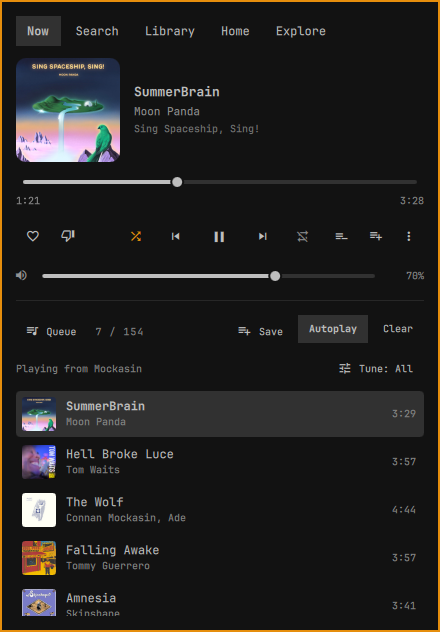
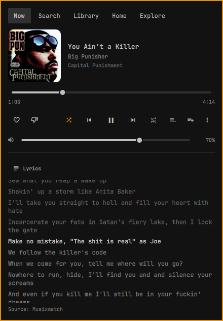
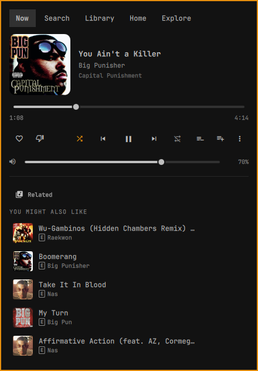
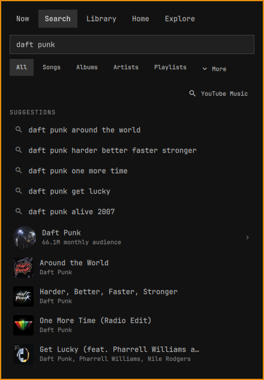
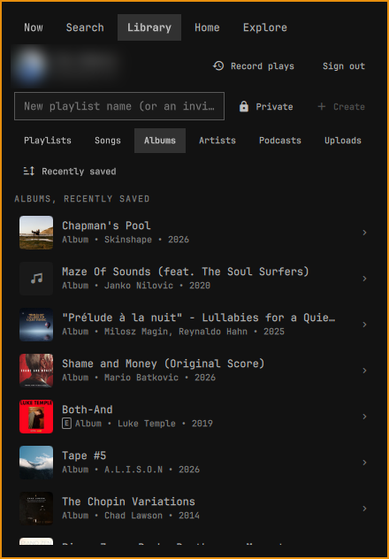
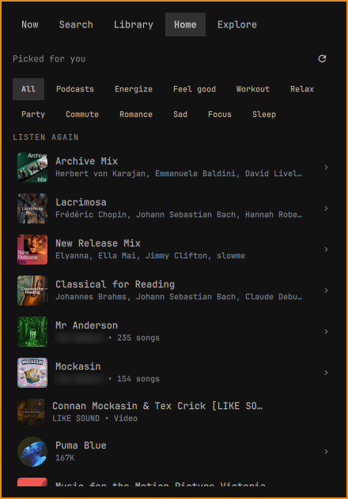
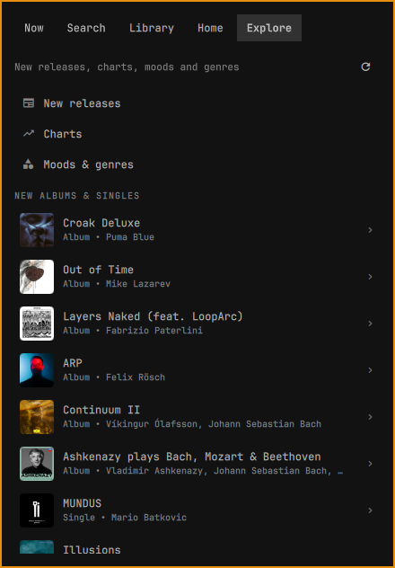
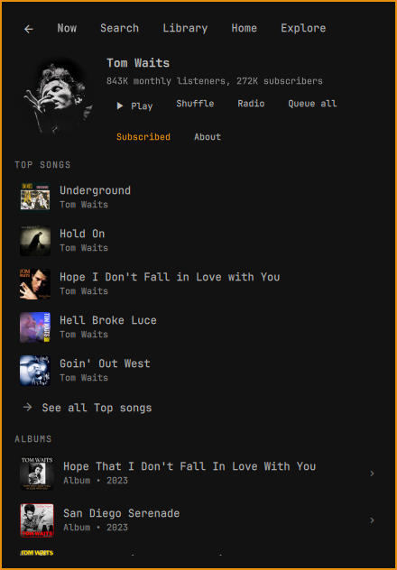
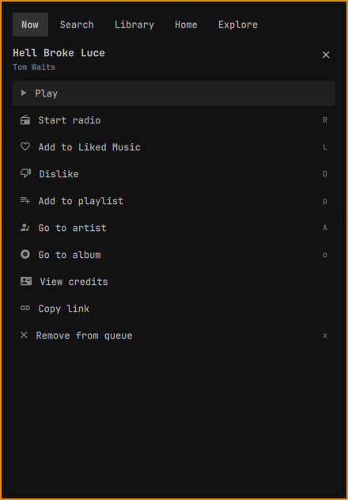
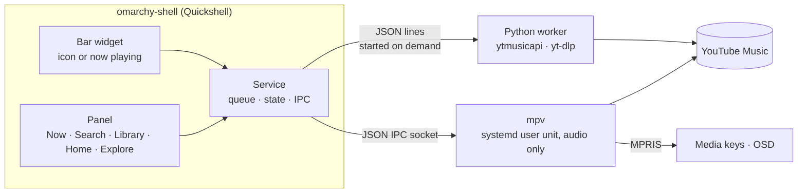

```text
                 ▄▄▄
 ▄█████▄    ▄███████████▄    ▄███████   ▄███████   ▄███████   ▄█   █▄    ▄█   █▄
███   ███  ███   ███   ███  ███   ███  ███   ███  ███   ███  ███   ███  ███   ███
███   ███  ███   ███   ███  ███   ███  ███   ███  ███   █▀   ███   ███  ███   ███
███   ███  ███   ███   ███ ▄███▄▄▄███ ▄███▄▄▄██▀  ███       ▄███▄▄▄███▄ ███▄▄▄███
███   ███  ███   ███   ███ ▀███▀▀▀███ ▀███▀▀▀▀    ███      ▀▀███▀▀▀███  ▀▀▀▀▀▀███
███   ███  ███   ███   ███  ███   ███ ██████████  ███   █▄   ███   ███  ▄██   ███
███   ███  ███   ███   ███  ███   ███  ███   ███  ███   ███  ███   ███  ███   ███
 ▀█████▀    ▀█   ███   █▀   ███   █▀   ███   ███  ███████▀   ███   █▀    ▀█████▀
                                       ███   █▀

           ━━━━━━━━  YouTube Music · a native Omarchy plugin  ━━━━━━━━
```

<div align="center">

# YouTube Music for Omarchy

[](https://github.com/InsightfulAnalytics/omarchy_ytmusic/releases)
[](LICENSE)
[](https://github.com/basecamp/omarchy)


Plugin id `tim.ytmusic` · the Omarchy logo is from [basecamp/omarchy](https://github.com/basecamp/omarchy) (MIT)

</div>

YouTube Music in the Omarchy bar, without a browser: a native panel inside
`omarchy-shell`, [ytmusicapi](https://github.com/sigma67/ytmusicapi) for
search and your library, and mpv with yt-dlp for audio-only streaming.
Nothing is downloaded to disk.

Version 2.0.0. Not affiliated with YouTube or Google: it uses the unofficial
ytmusicapi and yt-dlp, which can break when YouTube changes something
(`omarchy update` usually brings the yt-dlp fix).

## Everything the web app does

The panel matches [music.youtube.com](https://music.youtube.com) feature for
feature: every tab (Home, Explore, Library), every page (albums, playlists,
artists, mixes, podcasts, episodes, profiles, charts, moods and genres), every
shelf with its See all and Play all, every three-dot menu entry, and the
account settings (brand accounts, audio quality, content location, history).
Your playlists are fully editable, collaborators, voting and suggestions
included, and uploads, Listen again pins, the taste profile and Home's
feedback all work as they do on the web.

Three things stay on the web, by design:

- **Video**: music videos play as audio only.
- **Reporting a song**: YouTube's moderation form needs a browser. Copy link
  gives you the URL to report it from.
- **Setting a custom playlist image**: it needs YouTube's file uploader.
  Removing one is in the playlist editor.

## And more than the web app

- **No browser, almost no memory**: about 75 MiB while playing and nothing
  when idle, against ~700 MiB for a browser-based player.
- **Keyboard first**: every action has a key (`j` / `k` to move, `n` play
  next, `p` add to playlist, `x` remove, `?` lists them all), and Back
  returns to the row you left.
- **Picks up where you stopped**: the queue, the song and its position come
  back after mpv quits, a logout or a reboot.
- **Find in any long list**: `f` filters a playlist, Liked Music, History,
  an album or a podcast's episodes by title, artist or album, ignoring case
  and accents.
- **Edit the playlist that's playing**: take a song out of your playlist
  straight from its queue row, its menu or the Now controls.
- **Playback speed for music too** (0.5x to 2x), kept apart from podcast
  episodes' speed, and a **Dynamic** loudness mode besides YouTube's own
  levelling.
- **Private typing**: results while you type are read signed out, so
  half-typed words never land in your YouTube search history. Plays reach
  your history only if you turn **Record plays** on.
- **Fast starts**: the songs you're likely to play next are looked up ahead
  (the next one starts in about half a second), and pages and covers come
  from a disk cache.
- **Scriptable**: media keys, the OSD, `omarchy-shell ytmusic play "song"`
  and the `bin/ytm` command line (search, upload, join a collaborative
  playlist).

## At a glance

- 🔎 **Search** as you type, like the web: songs, videos, albums, artists, playlists, podcasts, episodes and profiles, Show all, spelling fixes, your library and uploads, and suggestions with your past searches
- 🎶 **Queue** with shuffle, repeat and autoplay (similar songs when it runs out); while it plays one of your playlists, take a song out of that playlist from its row, its menu or Now
- 🎤 **Lyrics**, time-synced where YouTube has them, **Related** and song credits for what's playing
- 📚 **Your library**: playlists (create, add, remove, delete; edit, reorder, suggestions, collaborators and votes; save whole albums, playlists or the queue into one), songs (with Shuffle all), albums, artists, subscriptions, recent activity and the profiles you subscribe to, each in YouTube's sort orders; save albums, playlists and songs to it and subscribe to artists, channels and profiles (`S`); likes, dislikes (`D`) and Liked Music, History (remove entries; your plays go there once you turn it on), Home, Your channel
- 👤 **Artist and album pages**, one click from what's playing: every shelf of an artist's page (top songs, albums, singles, videos, live performances, playlists, related artists) with See all, Shuffle, Radio and About
- 🏠 **Home** as the web has it: every shelf (Listen again, Mixed for you, New releases, Recaps, Quick picks...) with See all and Play all, and the mood chips (Relax, Workout, Podcasts...)
- 🧭 **Explore**: new albums and singles, Top songs and Trending with their chart ranks, new music videos, Charts for Global and YouTube's 68 chart countries, and every mood and genre
- 📌 **Recommendations**: pin songs, albums, playlists and artists to Listen again, Not interested and Don't recommend artist on Home's cards, and artists you like added to your taste profile
- 🎧 **Podcasts**: shows, episodes with chapters, Episodes for Later, New episodes and channels, each episode resuming where you left it
- ⏯️ **Media keys and OSD** over MPRIS; the bar shows a music icon

## Screenshots

<table>
  <tr>
    <td align="center" width="33%"><br><b>Now</b><br><sub>The song, its controls and the queue</sub></td>
    <td align="center" width="33%"><br><b>Lyrics</b><br><sub>Time-synced where YouTube has them</sub></td>
    <td align="center" width="33%"><br><b>Related</b><br><sub>More like what's playing</sub></td>
  </tr>
  <tr>
    <td align="center"><br><b>Search</b><br><sub>Results as you type, read signed out</sub></td>
    <td align="center"><br><b>Library</b><br><sub>Your playlists, songs, albums and artists</sub></td>
    <td align="center"><br><b>Home</b><br><sub>Every shelf and mood chip from the web</sub></td>
  </tr>
  <tr>
    <td align="center"><br><b>Explore</b><br><sub>New releases, charts, moods and genres</sub></td>
    <td align="center"><br><b>Artist pages</b><br><sub>Every shelf, with Shuffle and Radio</sub></td>
    <td align="center"><br><b>Menus</b><br><sub>The web's three-dot menu, on every row</sub></td>
  </tr>
</table>

```text
Memory while playing (PSS, measured on a 16 GB Omarchy laptop)

Chromium-based player   ████████████████████████████████████████   ~700 MiB
this plugin, playing    ████                                        ~75 MiB
this plugin, idle                                                     0 MiB
```

## Install

```bash
omarchy-pkg-add uv deno    # mpv, mpv-mpris, yt-dlp and wl-clipboard already come with Omarchy
omarchy plugin add https://github.com/InsightfulAnalytics/omarchy_ytmusic.git --enable
```

`uv` runs the ytmusicapi helper (it builds its own Python environment on
first use), `deno` is yt-dlp's solver for YouTube's JavaScript challenge and
`wl-copy` (wl-clipboard) puts Copy link on the clipboard; if one is missing,
the panel shows a banner with an **Install** button. `omarchy plugin update`
pulls new versions.

Then:

- **Sign in** for your playlists, likes, history and Home: Library → **Sign
  in** (or `~/.config/omarchy/plugins/tim.ytmusic/bin/ytm auth`). It copies
  your YouTube session from Chromium, so be signed in to YouTube there.
  Search and playback work without it.
- **Add a shortcut** in `~/.config/hypr/bindings.lua`. This one takes over
  Omarchy's own Music key:

  ```lua
  o.rebind("SUPER + SHIFT + M", "YouTube Music", { panel = "tim.ytmusic" })
  ```

- **Check the installation**: `~/.config/omarchy/plugins/tim.ytmusic/bin/ytm selftest --online`.

Uninstall: `bin/ytm logout`, then `omarchy plugin remove tim.ytmusic` and
`rm -rf ~/.cache/omarchy-ytmusic`.

## Using it

Click the bar icon (or your shortcut) to open the panel; middle click
plays and pauses, the wheel skips. The five tabs are **Now** (the song,
the queue, lyrics and Related), **Search**, **Library**, **Home** and
**Explore**; `1` to `5` switch between them. Every row has a menu (`m`,
right-click or its ⋮ button) with the same entries as the web's three-dot
menu, and `M` opens the page's own menu (on Library, your account).

| Keys | |
|---|---|
| Move | `j` / `k` / `↑` / `↓` · `g` / `G` first and last row · `Enter` play or open · `Esc` back · `/` search · `h` / `l` the page's chips, or seek 10 s on Now |
| Play | `Space` play/pause · `n` play next · `a` add to queue · `R` start radio · `s` shuffle · `r` repeat · `[` / `]` speed |
| Song | `L` like · `D` dislike · `S` save to library or subscribe · `p` add to playlist · `A` go to artist · `o` go to album · `x` remove · `J` / `K` move a song in the queue or your playlist |
| Pages | `m` the row's menu · `M` the page's menu · `f` find in the list · `O` next sort order · `e` edit your playlist · `y` Queue, Lyrics or Related · `t` tune the queue · `?` every key |

Every feature in detail, tab by tab: [docs/FEATURES.md](docs/FEATURES.md).

### Signing in

`bin/ytm auth` (or **Sign in** in the Library tab) copies the YouTube session
from your Chromium profile (`~/.config/chromium/Default`; another one with
`--from-browser chromium:PROFILE`) straight from the cookie store, never
through the clipboard (Omarchy's clipboard history is saved in plain text).
The new session is verified before it replaces the old one. If YouTube stops
accepting it you get one notification (click it to sign in again) and a
banner in the panel, while search and playback keep working.
`bin/ytm auth --paste` accepts request headers instead.

### From a script

```bash
omarchy-shell ytmusic status                    # JSON: player, worker, auth, now playing, queue
omarchy-shell ytmusic play "boards of canada"   # search songs, play the best match
omarchy-shell ytmusic queue "nils frahm says"   # search songs, add the best match
omarchy-shell ytmusic playPause|next|previous|stop|resume
omarchy-shell ytmusic seek 90
omarchy-shell ytmusic volume 60
omarchy-shell ytmusic search "query"            # open the panel on the results
omarchy-shell ytmusic like|unlike|toggleLike    # the song playing
omarchy-shell ytmusic shuffle|repeat|autoplay|recordPlays
bin/ytm upload ~/Music/song.mp3                 # a file to your uploads
bin/ytm join 'https://music.youtube.com/playlist?list=PL...&jct=...'   # join a collaborative playlist
```

## How it works



mpv runs in its own systemd user unit, so music keeps playing through shell
restarts, and quits after 5 minutes idle (30 paused). The worker starts when
the panel needs it and exits after 3 idle minutes. The panel is unloaded 45 s
after it closes.

## Privacy and security

- The session lives in `~/.config/omarchy-ytmusic/` (0700; `browser.json`,
  `cookies.txt`, `account.json` 0600). The shell reads only `account.json`
  (name, handle, photo) and `identity.json` (ids only, below), nothing
  else there; the worker reads the session, and mpv's yt-dlp only
  a copy of `cookies.txt` (for uploaded songs, and for every song
  while **Play with your account** is on), by file path. `identity.json`
  (0600) holds only the ids of the identity in use (a brand account's
  pageId, a login index); the names of the session's identities stay in
  the worker's replies and the shell's memory (`accounts` is not cached),
  never in a file or the log.
- No session data in the git history (scanned for cookie values and account
  e-mails), the journal, `omarchy-shell ytmusic status` or process command
  lines. Recorded fixtures are scrubbed, and `scripts/test.sh` fails on
  cookie-looking data in them.
- `~/.cache/omarchy-ytmusic/` is 0700, `data/` and `thumbs/` files 0600. The
  shell writes `session.json`, `player.json`, `searches.json`, `queue.json`,
  `positions.json` and `pending-plays.json` with the
  default umask (0644); the 0700 directory keeps them private.
- Covers are only downloaded over HTTPS from YouTube/Google image hosts.
- External text never reaches a shell: notifications and processes get
  argument arrays, mpv titles use byte-length quoting, and the two `sh -c`
  calls (mkdir for the cache, the tool check) take their arguments as
  positional parameters (`$1`, `$@`: the cache path, fixed tool names).
- The `ytmusic` IPC target, like all Omarchy shell IPC, answers any process of
  your user (including `signOut`).
- ytmusicapi is pinned; yt-dlp deliberately is not, because YouTube changes
  need fresh releases.

## Troubleshooting

| Symptom | What to do |
|---|---|
| "YouTube Music playback keeps failing" | yt-dlp is probably out of date for a YouTube change: `omarchy update`, then press play (it continues from the song that failed). `mpv --no-video 'https://www.youtube.com/watch?v=…'` shows yt-dlp's own error. |
| "YouTube is refusing playback for now" | YouTube's bot check: too many requests from this connection (or a shared or VPN address). Waiting is the fix, usually minutes to an hour; for ten minutes the panel looks nothing up in the background. Then press play. Signed in, **Play with your account** (Library's `M` menu) gets past it. |
| "Can't reach YouTube Music" | No connection. Press play once it's back; the queue is kept. |
| Sign-in expired (banner, notification) | Make sure you're signed in to YouTube in Chromium, then **Sign in again** (or `bin/ytm auth`). `bin/ytm auth --from-browser chromium:"Profile 1"` picks another profile. |
| Library, playlist or Home looks stale | It refreshes itself right after showing the cached copy. `rm -rf ~/.cache/omarchy-ytmusic/data` is always safe. |
| No bar icon | `omarchy plugin list \| grep ytmusic`, `omarchy plugin validate ~/.config/omarchy/plugins/tim.ytmusic`. |
| Something odd | `omarchy-shell ytmusic status \| jq` (player, worker, auth, last error), `bin/ytm selftest --online`, `journalctl --user -b \| grep ytmusic`. mpv itself runs with `--no-terminal`, so it logs almost nothing. |
| Start over | `bin/ytm logout` and `rm -rf ~/.cache/omarchy-ytmusic`. |

## Credits

Built on [Damir Sagi's omarchy-ytmusic](https://github.com/Damir-VistaBlox/omarchy-ytmusic)
(MIT), extended to the whole of YouTube Music's web app.
[ytmusicapi](https://github.com/sigma67/ytmusicapi),
[yt-dlp](https://github.com/yt-dlp/yt-dlp) and [mpv](https://mpv.io) do the
heavy lifting.

## Development

How it is put together, the worker protocol and the measurements behind
the design: [docs/DEVELOPMENT.md](docs/DEVELOPMENT.md). Root causes of past
bugs: [LEARNINGS.md](LEARNINGS.md). Run the tests with `scripts/test.sh`.

## License

MIT: see [LICENSE](LICENSE).
