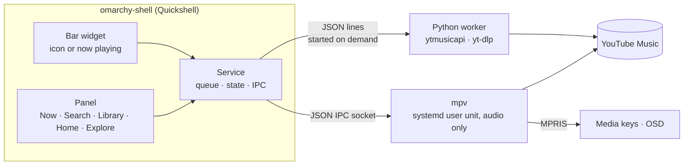

```text
                 ▄▄▄
 ▄█████▄    ▄███████████▄    ▄███████   ▄███████   ▄███████   ▄█   █▄    ▄█   █▄
███   ███  ███   ███   ███  ███   ███  ███   ███  ███   ███  ███   ███  ███   ███
███   ███  ███   ███   ███  ███   ███  ███   ███  ███   █▀   ███   ███  ███   ███
███   ███  ███   ███   ███ ▄███▄▄▄███ ▄███▄▄▄██▀  ███       ▄███▄▄▄███▄ ███▄▄▄███
███   ███  ███   ███   ███ ▀███▀▀▀███ ▀███▀▀▀▀    ███      ▀▀███▀▀▀███  ▀▀▀▀▀▀███
███   ███  ███   ███   ███  ███   ███ ██████████  ███   █▄   ███   ███  ▄██   ███
███   ███  ███   ███   ███  ███   ███  ███   ███  ███   ███  ███   ███  ███   ███
 ▀█████▀    ▀█   ███   █▀   ███   █▀   ███   ███  ███████▀   ███   █▀    ▀█████▀
                                       ███   █▀

           ━━━━━━━━  YouTube Music · a native Omarchy plugin  ━━━━━━━━
```

<div align="center">

# YouTube Music for Omarchy

[](https://github.com/Damir-VistaBlox/omarchy-ytmusic/releases)
[](LICENSE)
[](https://github.com/basecamp/omarchy)


Plugin id `damir.ytmusic` · the Omarchy logo is from [basecamp/omarchy](https://github.com/basecamp/omarchy) (MIT)

</div>

YouTube Music for the Omarchy bar without a browser: a native panel inside
`omarchy-shell`, [ytmusicapi](https://github.com/sigma67/ytmusicapi) for search
and your library, and mpv (with yt-dlp) for audio-only streaming. Nothing is
downloaded to disk.

Version 1.0.0. Not affiliated with YouTube or Google: it uses the unofficial
ytmusicapi and yt-dlp, which can break when YouTube changes something
(`omarchy update` usually brings the yt-dlp fix).

## At a glance

- 🔎 **Search** as you type, like the web: songs, videos, albums, artists, playlists, podcasts, episodes and profiles, Show all, spelling fixes, your library and uploads, and suggestions with your past searches
- 🎶 **Queue** with shuffle, repeat and autoplay (similar songs when it runs out)
- 🎤 **Lyrics**, time-synced where YouTube has them, **Related** and song credits for what's playing
- 📚 **Your library**: playlists (create, add, remove, delete; edit, reorder, suggestions, collaborators and votes; save whole albums, playlists or the queue into one), songs (with Shuffle all), albums, artists, subscriptions and recent activity, each in YouTube's sort orders; save albums, playlists and songs to it and subscribe to artists (`S`); likes, dislikes (`D`) and Liked Music, History (remove entries; your plays go there once you turn it on), Home
- 👤 **Artist and album pages**, one click from what's playing: every shelf of an artist's page (top songs, albums, singles, videos, live performances, playlists, related artists) with See all, Shuffle, Radio and About
- 🏠 **Home** as the web has it: every shelf (Listen again, Mixed for you, New releases, Recaps, Quick picks...) with See all and Play all, and the mood chips (Relax, Workout, Podcasts...)
- 🧭 **Explore**: new albums and singles, Top songs and Trending with their chart ranks, new music videos, Charts in any of YouTube's 69 countries, and every mood and genre
- 📌 **Recommendations**: pin songs, albums, playlists and artists to Listen again, Not interested and Don't recommend artist on Home's cards, and artists you like added to your taste profile
- ⏯️ **Media keys and OSD** over MPRIS; the bar shows an icon or scrolling now-playing text
- ⚡ **Fast starts**: streams are looked up ahead, pages and covers come from a disk cache
- 🪶 **Light**: no browser; ~75 MiB while playing, nothing when idle; resumes where you stopped

<p align="center">
  
  &nbsp;
  
</p>

```text
Memory while playing (PSS, measured on a 16 GB Omarchy laptop)

Chromium-based plugin   ████████████████████████████████████████   ~700 MiB
this plugin, playing    ████                                        ~75 MiB
this plugin, idle                                                     0 MiB
```

## Install

```bash
omarchy-pkg-add uv deno    # mpv, mpv-mpris, yt-dlp and wl-clipboard already come with Omarchy
omarchy plugin add https://github.com/Damir-VistaBlox/omarchy-ytmusic.git --enable
```

`uv` runs the ytmusicapi helper (it builds its own Python environment on
first use), `deno` is yt-dlp's solver for YouTube's JavaScript challenge and
`wl-copy` (wl-clipboard) puts Copy link on the clipboard; if one is missing,
the panel shows a banner with an **Install** button.
`omarchy plugin update` pulls new versions.

Optional:

- **Sign in** for your playlists, likes, history and Home: Library → **Sign
  in** (or `~/.config/omarchy/plugins/damir.ytmusic/bin/ytm auth`). It copies
  your YouTube session from Chromium, so be signed in to YouTube there.
- **Shortcut**, e.g. in `~/.config/hypr/bindings.lua`:
  `o.bind("SUPER + M", "YouTube Music", "omarchy-shell shell toggle damir.ytmusic")`.
- **Check the installation**: `~/.config/omarchy/plugins/damir.ytmusic/bin/ytm selftest --online`.

Uninstall: `bin/ytm logout`, then `omarchy plugin remove damir.ytmusic` and
`rm -rf ~/.cache/omarchy-ytmusic`.

For development, clone into `~/.config/omarchy/plugins/damir.ytmusic` (a
real directory — the shell's file watcher and `omarchy plugin validate` don't
follow symlinks) and run `scripts/test.sh`.

## Using it

| Where | Action |
|---|---|
| Bar icon | Left click: open/close the panel · Middle click: play/pause · Right click: switch icon ⇄ now-playing text · Wheel: previous/next track |
| `SUPER + M` | Open/close the panel (`omarchy-shell shell toggle damir.ytmusic`, bound in `~/.config/hypr/bindings.lua`) |
| Panel tabs | **Now** (playing + queue, like, dislike (the song skips), add to playlist, **Save** the queue into a playlist, Resume; an artist, the album or the cover opens its page; the queue header's pane chip, or `y`, switches the area below to **Lyrics**, time-synced with the line being sung highlighted when YouTube has them, or **Related**, the web's Related tab as a page), **Search** (field, filter chips with More, a scope chip, grouped results with Show all), **Library** (account, new playlist (with a privacy chip, `Alt+Left` / `Alt+Right` while typing, and an optional description; an invite link pasted there joins that playlist instead), and chips switched with `h` / `l`: **Playlists** with Liked Music, History, Recent activity and your and saved playlists; **Songs** with Shuffle all (YouTube's shuffle of the whole library); **Albums**; **Artists** with Subscriptions. `O` or the sort button cycles a chip's sort order, named in its first heading; the chip and each order are remembered, and YouTube saves the order on your account as the web does. Long lists load about 50 at a time), **Home** (every shelf of the web's feed, loaded a few at a time as you scroll, with the mood chips above it switched with `h` / `l`; a shelf ends in **See all** when the web has one and in **Play all** when it plays as a list, the list YouTube makes for it; a song plays its shelf from there, a mix opens as its page, and a podcast as its list of episodes) and **Explore** (`5`: rows for **New releases**, **Charts** and **Moods & genres**, then New albums & singles, Top songs (Premium accounts), Moods & genres (eight, and a row that shows all of them: some are on no other page), Trending, New music videos and Popular episodes when YouTube has them, each ending in See all; chart songs and artists lead with their rank and a rising, falling or steady mark. **Charts** opens in the country you chose last (Global at first): its first row, `O` or its `M` menu lists YouTube's countries, and the choice is remembered. The Moods & genres page lists its groups (For you, Moods & moments, Genres), and a category its playlists in the web's titled shelves. When the five tab labels do not fit, the tabs show icons); albums, playlists, mixes and artists open as pages with Play / Shuffle / Queue all (a page that shows part of its list, such as Liked Music past 200 songs or an artist's five top songs, plays all of it). An album or playlist header has its byline (album type, artists and year, or the playlist's author; names are links, and `A` with no row selected opens the album's artist), details (privacy of your own playlist, songs, duration, views, year, and how many songs are unavailable) and two lines of the description, with an **About** row for the rest; songs marked explicit carry a small boxed E. A playlist or Liked Music longer than its first read (200 to 300 songs) ends in **Load all N songs**, which reloads the whole list (up to 5000) with the cursor kept; `f` filters the page's songs by title, artist or album, ignoring case and accents (it loads the whole list first; Down goes to the matches, Esc clears it). An album lists its track numbers and then Other versions and the served recommendations, a playlist its related playlists, and a mix (My Supermix and the like) its first 50 songs; your own playlists can remove songs and be deleted (a second click within 4 s confirms), be edited (`e` or **Edit**: title, description and privacy and, under Advanced, the order and voting (the choices YouTube offers, under its own names), where new songs go, an invite link for collaborators that is copied (it needs wl-copy), and Close collaboration while it is on; what YouTube does not report says so, and YouTube cannot clear a description), have songs moved with `J` / `K` or a row's arrows (a playlist sorted by date or votes asks for Manual order first), and end in YouTube's **Suggestions** (`i` adds the one under the cursor, Enter plays it, **Refresh suggestions** asks again); songs show their net votes (`+3`) when voting is on. Sectioned pages end each section in a selectable **See all** row and long lists in **Load more**, which also loads by itself when the cursor nears the end. An artist's page has every shelf of the web page in its order, from Top songs to Fans might also like (and From your library when signed in); See all opens the whole list (all albums or singles, with the served sort orders as chips), and the header adds **Radio** (the artist's radio mix) and **About** (description and links; Enter on a link copies it), while **Shuffle** plays YouTube's shuffle mix of the artist. An album, a playlist that is not yours and a mix have **Save** (**Saved** once in your library) and an artist **Subscribe** (**Subscribed**); `S` saves or subscribes the row under the cursor (a song too, from a list that offers it) or, with no row, the page, and `D` dislikes the row's song or the one playing, which skips. The change shows at once and is put back if YouTube refuses it; if the worker stopped before answering, the page or Library list is read again and a notice says so (on Search, Home and Explore it asks you to open the item again to check) |
| Menus | Every row has a menu (`m`, `.`, right-click or its ⋮ button), like the web's three-dot menu: Play, Shuffle, Play next, Add to queue, Start radio, Save to library or Remove from library (albums, playlists, mixes, songs), Subscribe or Unsubscribe, Add to or Remove from Liked Music, Dislike or Remove dislike, Add to playlist, Go to artist (a chooser when a song has several) or album, View credits (a song's performers, writers and producers as a page), Copy link (a music.youtube.com link, through `wl-copy`), Pin to or Unpin from Listen again (songs, and Home's albums, playlists and artists; the page menu pins an album, playlist, Liked Music or artist page; YouTube sometimes keeps an unpinned item there for a while), Not interested and Don't recommend artist on Home's cards (choose it twice within 4 s; the card leaves Home at once, and as with the web's Removed from Home toast, Home's `M` menu then offers Undo for 2 minutes), Save to playlist (a whole album or playlist; `p` on its row too) and Copy to new playlist (the picker asks again when a song is already there: Enter again adds it anyway), Remove, Remove from history (History rows; choose it twice), and for the song playing Play video version or Play song version. `n` / `a` queue a whole album, playlist or mix from any list, and `R` starts radio from the row, else from the artist page you are on, else from the song playing; radio replaces the queue, as on the web (from the song playing, that song plays on). At most 500 songs of one list go into the queue, with a notice. `M` opens the page's own menu: the header buttons' twins on a page (an artist's adds About; an album or playlist adds Load all, Find and About; your own playlist Edit playlist), the account on Library (**Add artists you like**: YouTube's suggested artists as a page, where `f` finds, Enter marks or unmarks one and the **Add N artists** row, pressed twice, adds the marked ones to your taste profile; it can only add, removing one is done on the web. Then Record plays in history and Sign out), Autoplay, Clear, Save the queue, Tune the queue, Playback speed and Loudness on Now, the scopes and More filters on Search, Refresh (and that Undo) on Home, Refresh on Explore, the country on Charts. `?` lists every key; Enter on one runs it. |
| Resume | After mpv has quit (idle timeout, logout, reboot) play/pause — middle click, media keys, `omarchy-shell ytmusic resume` or the Resume button — restores the queue, the track and its position. The snapshot is `~/.cache/omarchy-ytmusic/session.json`, saved after queue changes, on pause and every 30 s while playing. |
| Search | Results appear as you type. **All** lists every kind of result in the order YouTube serves them under the top result (an artist's top result plays its Shuffle and Radio mixes from the menu): songs, videos, albums, artists, playlists, podcasts, episodes and profiles, each ending in **Show all**, which switches to that filter. The chips are All, Songs, Albums, Artists, Playlists and **More** (Videos, Featured and Community playlists, Podcasts, Episodes, Profiles; the chip then shows the one chosen); `h` / `l` cycle through all of them. A filtered list loads more as the cursor nears its end. Signed in, the chip at the end of the status line (or `M`) searches **YouTube Music**, your **Library** or your **Uploads**. When YouTube corrected your spelling the status says "Showing results for ..." and a **Search instead for** row searches the words as typed. An empty field lists your recent searches merged with your YouTube searches (signed in); `x` removes one, from YouTube too. While typing, matching recent searches and YouTube Music's suggestions show above the results, then up to five artists, songs or albums that open or play; click one, or `Tab` / `Shift+Tab` to put a suggestion in the field. A search is remembered only when it led somewhere (Enter, a result played, opened or queued, or an entry chosen from a result's menu), in `~/.cache/omarchy-ytmusic/searches.json`. Podcasts and profiles open as their browse pages for now, uploaded albums too. |
| Shuffle / repeat | Buttons around the transport (or `s` / `r`). Shuffle mixes the songs after the current one and turning it off puts them back in their order (songs added meanwhile keep their places); with shuffle on, a clicked song plays first and the rest of its album or playlist follows shuffled, and a page's **Shuffle** button turns it on (an artist's plays YouTube's shuffle mix instead). Repeat cycles off → queue → this song (mpv's `loop-playlist` / `loop-file`, so MPRIS sees it too). Both are remembered in `~/.cache/omarchy-ytmusic/player.json`. |
| Autoplay | On by default (**Autoplay** in the queue header, IPC `autoplay`): like the web's Up next, the queue never runs dry. Five seconds into a song with 3 or fewer songs after it, up to 10 more are appended as radio for whatever plays: an album or playlist goes on as its radio, a radio as it is, a single song as its own mix (songs before videos, nothing this queue already holds or played). If every pick is a repeat it tries the song's own radio once, then says "Autoplay found nothing new". The queue header shows **Playing from** (the album, playlist or radio) and one **Tune** chip (`t`, or a click, cycles All, Discover, Popular, Deep cuts and the rest; the Now page menu `M` lists them all): a chip replaces only the songs autoplay added, never yours, and songs you add go before autoplay's. For the song playing, its menu offers **Play video version** or **Play song version** when YouTube has the other one. Played songs more than 50 behind the current one leave the queue, so it stays small however long it runs; which entries autoplay added is kept in `~/.cache/omarchy-ytmusic/queue.json`. Off while repeat is on. |
| Speed / loudness | `[` / `]` (any tab) or **Playback speed** in the Now page menu (`M`) play at 0.5x to 2x in steps of 0.25; Now shows a small **1.5x** badge (click it for the speeds) while it is not 1x. Music and podcast episodes keep separate speeds, applied whenever the kind of entry playing changes. **Loudness** in the same menu: **Off** (as the music comes), **YouTube** (like the web player: a song YouTube measures louder than its target is turned down by that much, never boosted; one more request per resolved song) or **Dynamic** (mpv's `dynaudnorm`, which evens out loud and quiet passages and so changes the music's dynamics). Both are remembered in `player.json`. A player started before `mpv/ytm-levels.lua` existed has it loaded by the shell (mpv's `load-script`). |
| History | Off until you turn it on: **Record plays** on Library's account row (it reads **Recording plays** while on), **Record plays in history** in its `M` menu, or IPC `recordPlays`. Then every song, video or episode played for 10 s or more (mpv's position; a repeat-one loop counts again) goes to your YouTube Music history, as on the web, so it reaches History, Listen again, Recaps and your recommendations. Plays wait in `~/.cache/omarchy-ytmusic/pending-plays.json` (at most 200, none older than a day) and go in one batch when the worker is running anyway, when a panel opens, when 5 are waiting or 15 minutes after the oldest, so playing with the panel closed never starts the worker for one song. A batch whose outcome is unknown (the worker or the shell stopped mid-call) is dropped, not sent again: a missing play beats one counted twice. Turning it off, signing out or switching account drops what waits. While it is off, the first play of 10 s shows a one-time notice saying how to turn it on. On the History page, `x` pressed twice within 4 s (or the row's remove button clicked twice, or **Remove from history** in its menu) removes the entry from your YouTube Music history; it goes at once and comes back if YouTube refuses. |
| Panel keys | `1-5` switch tab: Now, Search, Library, Home, Explore · `/` search · `j` / `k` / `↑` / `↓` move · `g` first row · `G` last row (loads more), or a long list's Load all row · `Enter` play or open · `h` / `l` / `←` / `→` seek 10 s on Now, or the page's chips · `Esc` leave the field → close the picker, editor or menu → clear the filter → back → close · `Space` play/pause · `n` play next (a song, album or playlist) · `a` add to queue · `R` start radio from the row, the artist page or the current song · `s` shuffle · `r` repeat · `L` like · `S` save to library or subscribe (the row, else the page) · `D` dislike the row's song (again to undo) or the one playing, which skips · `p` add to playlist (the song, or a whole album or playlist row) · `A` go to artist (of the row, the album page or the current song) · `o` go to album · `J` / `K` move a queued song, or a song of your own playlist, down / up · `i` add the suggestion under the cursor to your playlist · `x` remove (queue, own playlist, Liked Music, recent search; History: press twice) · `m` / `.` the row's menu (or right-click) · `M` the page's menu (Library: account) · `O` next sort order on a page that has one (Charts: the country) · `f` find in a page's songs (album, playlist, Liked Music, History) or the suggested artists · `e` edit your playlist: details, order, voting, collaborators · `?` these keys · `y` cycle the pane under the song: Queue, Lyrics, Related · `t` cycle the queue tuner chip: All, Discover, Popular and the rest · `[` / `]` playback speed down / up (0.5x to 2x, kept apart for episodes). Shortcuts are off while typing, and Ctrl or Alt chords do nothing. Back returns to the row and scroll position you left. |
| IPC | `search "query"` (opens the panel on the results) · `shuffle` / `repeat` / `autoplay` / `recordPlays` (toggle or cycle, print the new state; `recordPlays` is plays in YouTube Music history) · `like` / `unlike` / `toggleLike` (current track) · `signIn` / `signOut` / `reloadAuth` · `join "<invite link>"` (join a collaborative playlist; `bin/ytm join` does the same) |

### Signing in

`bin/ytm auth` (or **Sign in** in the Library tab) copies the YouTube session
from your Chromium profile (`~/.config/chromium/Default`; another one with
`--from-browser chromium:PROFILE`) straight from the cookie store, never through the
clipboard (Omarchy's clipboard history is saved in plain text). The new
session is verified before it replaces the old one. The shell only reads
`account.json`; if YouTube stops accepting the session you get one
notification (click it to sign in again) and a banner in the panel, while
search and playback keep working. `bin/ytm auth --paste` accepts request
headers instead.

Bar display is a per-widget setting: `omarchy bar set damir.ytmusic display player`
(or `icon`). The panel is created on first open and unloaded 45 s after it
closes, so it holds no memory while you're not looking at it.

## How it works



mpv runs in its own systemd user unit, so music keeps playing through shell
restarts, and quits after 5 minutes idle (30 paused). The worker starts when
the panel needs it and exits after 3 idle minutes. The panel is unloaded 45 s
after it closes.

## Layout

| Path | Purpose |
|---|---|
| `manifest.json` | Omarchy plugin manifest (service + bar widget) |
| `Service.qml` | State, mpv and worker connections, `ytmusic` IPC target |
| `MpvClient.qml` | mpv JSON IPC client: request ids, observers, reconnects, starts the player |
| `Backend.qml` | ytmusicapi worker process: lazy start, request/callback, retry once (never for edits) |
| `YtmModel.js` | Pure helpers (queue commands, queue model, formatting, prefs, page kinds and See all routes, page rows, cursor keeping, the menu registry and the key table); shared with Node tests |
| `BarWidget.qml` | Bar icon / now-playing, one per monitor; loads and unloads the panel |
| `Panel.qml` | The dropdown (Omarchy `KeyboardPanel`): now playing + queue, keyboard control |
| `Store.qml` | Last searches, the Explore page (30 min), recently opened pages (8, 5 min, Moods & genres a day, at most 3000 items each), the Library chips' lists (5 min, at most 2000 items each), Home's feed per chip (4 chips, 10 min, at most 40 shelves each), the songs' now contexts (20, 10 min) and lyrics (the 20 last shown, 30 min), swept every minute, shared by all panels and kept across panel unloads |
| `components/` | `NowPlayingView`, `QueueView` (with the pane chip), `LyricsView`, `RelatedView`, `SearchView`, `LibraryView`, `HomeView`, `ExploreView`, `CollectionView`, `PlaylistPicker`, `PlaylistEditor`, `ItemMenu` (row menu, chooser, key help), `SignInCard`, `ResultList`, `TrackRow`, `CollectionRow`, `CoverArt`, `ConfirmGate`, `ExplicitBadge` |
| `bin/ytm-mpv` | Starts/stops the detached mpv player (systemd user unit) |
| `mpv/ytm-idle.lua` | Quits mpv after it has idled or been paused too long |
| `mpv/ytm-streams.lua` | Plays the streams the worker resolved ahead of time (`user-data/ytm/streams`), falling back to yt-dlp |
| `mpv/ytm-levels.lua` | Loudness levelling (`user-data/ytm/normalize`): YouTube's per-song gain as each file's own `volume-gain`, or the `dynaudnorm` filter |
| `backend/ytm.py` | ytmusicapi worker (`serve`) and CLI; PEP 723 script run with `uv`; merges the area modules' method tables |
| `backend/ytm_proto.py` | `WorkerError` and parameter helpers shared by the worker and its area modules |
| `backend/ytm_pages.py` | Continuation paging (`fetch`) and the generic See all reader (`browsePage`) |
| `backend/ytm_play.py` | Whole collections as track lists (`tracksFor`), Start radio (`radio`), album pages from audio playlists (`albumBrowseId`) |
| `backend/ytm_now.py` | The song playing's context in one request (`nowContext`, `likeStatus`), autoplay's lists (`upNext`, `queueFrom` for a tuner chip), lyrics (synced through the signed-out client), Related and song credits |
| `backend/ytm_library.py` | The library's playlists, songs, albums, artists, subscriptions and recent activity a page at a time, with their sort orders; Shuffle all |
| `backend/ytm_artist.py` | Artist pages from `get_artist` plus its raw rows (`artist`), discographies a page at a time with their sort orders (`artistAlbums`) |
| `backend/ytm_actions.py` | Library actions: save albums and playlists (`rateCollection`), subscribe (`subscribe`), songs in the library (`songLibrary`); a page header's library toggle |
| `backend/ytm_search.py` | Search (`search`: every result type, the top result card, spelling, library and uploads scopes, filtered lists by cursor) and its suggestions (`suggestions` with rich rows and your past searches, `removeSuggestion`) |
| `backend/ytm_home.py` | Home's whole feed from the raw browse (`homeFeed`: shelves with their See all and Play all, the mood chips, a page of shelves at a time) and a shelf's Play all (`shelfQueue`) |
| `backend/ytm_feedback.py` | Recommendations: Listen again pins, Home's Not interested and Don't recommend (`feedback`), the taste profile (`tasteProfile`, `setTasteProfile`) |
| `backend/ytm_edit.py` | Playlist edits: details, order, voting and collaboration (`editPlaylist`), moves, adds with the duplicate prompt, copies, joins; an owned playlist's settings and suggestions |
| `backend/ytm_collections.py` | Albums, playlists, mixes, Liked Music and History (`album`, `playlist`, `liked`, `history`): first reads and whole reads, headers, related shelves |
| `backend/ytm_history.py` | Plays reported to YouTube Music history (`reportPlays`, report lane) and History entries removed (`removeHistory`) |
| `backend/ytm_explore.py` | The Explore page (`explore`), Charts per country (`charts`), Moods & genres (`moods`) and a mood's playlists (`mood`), from ytmusicapi plus the raw rows |
| `backend/ytm_raw.py` | Raw responses beside ytmusicapi's: per-thread capture, rows with See all/Play all endpoints, items by page type, HTTP counts; menu entries by icon (Listen again pins, Not interested, Don't recommend) |
| `backend/ytm_normalize.py` | Turns ytmusicapi responses into stable Track/Album/Playlist/Artist/Collection/Page shapes |
| `backend/ytm_auth.py` | Session files and sign-in (Chromium cookie import, pasted headers); the signed-out client |
| `backend/ytm_cache.py` | Response cache (schema-prefixed, cursor-free) and cover thumbnails |
| `backend/ytm_streams.py` | Stream URLs through in-process yt-dlp (signed out, or with the account), with YouTube's loudness for levelling |
| `bin/ytm` | CLI wrapper (`uv run --script backend/ytm.py`, no bytecode) |
| `scripts/test.sh` | Fixture secrets check + node + pytest, without caches |
| `scripts/mem.sh` | PSS report: shell, mpv unit, worker |
| `tests/` | Backend tests and anonymous recorded fixtures |

Private files live outside this repository:

| Path | Contents |
|---|---|
| `~/.config/omarchy-ytmusic/` (0700) | `browser.json`, `cookies.txt` (0600), `account.json` |
| `$XDG_RUNTIME_DIR/omarchy-ytmusic/` (0700) | mpv IPC socket |
| `~/.cache/omarchy-ytmusic/` (0700) | resume snapshot (`session.json`), preferences (`player.json`), recent searches (`searches.json`), the queue's autoplay entries, "Playing from" and tuner chip (`queue.json`), plays waiting for YouTube Music history (`pending-plays.json`), response and cover caches |

## Commands

```bash
omarchy-shell ytmusic ping
omarchy-shell ytmusic status                    # JSON: mpv, worker, auth, now playing, queue
omarchy-shell ytmusic play "boards of canada"   # search songs, play the best match
omarchy-shell ytmusic queue "nils frahm says"   # search songs, add the best match
omarchy-shell ytmusic playPause|next|previous|stop
omarchy-shell ytmusic seek 90
omarchy-shell ytmusic volume 60
bin/ytm-mpv start|stop|status
scripts/mem.sh

bin/ytm auth                      # sign in: import the session from a Chromium profile
bin/ytm auth --paste              # fallback: paste request headers of a /browse call
bin/ytm whoami | logout
bin/ytm search daft punk --filter songs
bin/ytm call search '{"query": "song exploder"}'                                    # All: top result, groups in served order
bin/ytm call search '{"query": "radiohead", "filter": "songs", "cursor": "c...."}'  # the next page of a filtered search
bin/ytm record searchRaw '{"query": "song exploder"}' tests/fixtures/search_raw.json  # signed out, trimmed
bin/ytm call libraryAlbums '{}'                   # first page of your albums (cursor for more)
bin/ytm call album '{"browseId": "MPREb_yXhSI4FCUo6", "cache": "prefer"}' --reply   # whole reply: cached, http, ms
YTM_DEBUG=1 bin/ytm call browsePage '{"browseId": "FEmusic_new_releases_albums"}'   # logs method, outcome, http, ms
bin/ytm call artistAlbums '{"browseId": "MPADUC...", "params": "...", "order": "Recency"}'  # an artist's whole album list
bin/ytm record artist '{"channelId": "UC..."}' tests/fixtures/artist.json            # signed out, scrubbed
bin/ytm call charts '{"country": "AU"}'                                            # Charts in Australia (ZZ: Global)
bin/ytm record explore '{}' tests/fixtures/explore.json                             # the raw Explore page
bin/ytm record playlist '{"playlistId": "PL...", "limit": 100, "related": true}' tests/fixtures/playlist_related.json
bin/ytm call playlist '{"playlistId": "PL...", "limit": "all"}'                     # every song (up to 5000)
YTM_DEBUG=1 bin/ytm call homeFeed '{}'                                               # Home's first shelves (http <= 3)
bin/ytm record homeRaw '{"pages": 3, "chip": 6}' tests/fixtures/home_raw.json        # signed out, trimmed
bin/ytm call playlistSettings '{"playlistId": "PL..."}'                           # your playlist's order, voting, privacy (read only)
bin/ytm join 'https://music.youtube.com/playlist?list=PL...&jct=...'              # join a collaborative playlist (the link is never printed)
bin/ytm call tasteProfile '{}'                                                    # the artists the taste builder suggests (read only)
bin/ytm selftest --online
scripts/test.sh
```

## Troubleshooting

| Symptom | What to do |
|---|---|
| "YouTube Music playback keeps failing" | yt-dlp is probably out of date for a YouTube change: `omarchy update`, then press play (it continues from the song that failed). `mpv --no-video 'https://www.youtube.com/watch?v=…'` shows yt-dlp's own error. |
| "Can't reach YouTube Music" | No connection. Press play once it's back; the queue is kept. |
| Sign-in expired (banner, notification) | Make sure you're signed in to YouTube in Chromium, then **Sign in again** (or `bin/ytm auth`). `bin/ytm auth --from-browser chromium:"Profile 1"` picks another profile. |
| Library, playlist or Home looks stale | It refreshes itself right after showing the cached copy. `rm -rf ~/.cache/omarchy-ytmusic/data` is always safe. |
| No bar icon | `omarchy plugin list \| grep ytmusic`, `omarchy plugin validate ~/.config/omarchy/plugins/damir.ytmusic`. |
| Something odd | `omarchy-shell ytmusic status \| jq` (player, worker, auth, last error), `bin/ytm selftest --online`, `journalctl --user -b \| grep ytmusic`. mpv itself runs with `--no-terminal`, so it logs almost nothing. |
| A QML change doesn't show | `omarchy restart shell` (hot reload keeps the old compiled QML). |
| Start over | `bin/ytm logout` and `rm -rf ~/.cache/omarchy-ytmusic`. |

## Security

Checked in Phase 7 (2026-09-11):

- The session lives in `~/.config/omarchy-ytmusic/` (0700; `browser.json`,
  `cookies.txt`, `account.json` 0600). The shell only reads `account.json`
  (name, handle, photo); the worker reads the session, and mpv's yt-dlp only
  when `YTM_STREAM_WITH_ACCOUNT=1`, and then by file path.
- No session data in the git history (scanned for cookie values and account
  e-mails), the journal, `omarchy-shell ytmusic status` or process command
  lines. Recorded fixtures are scrubbed, and `scripts/test.sh` fails on
  cookie-looking data in them.
- `~/.cache/omarchy-ytmusic/` is 0700, `data/` and `thumbs/` files 0600. The
  shell writes `session.json`, `player.json`, `searches.json`, `queue.json` and `pending-plays.json` with the
  default umask (0644); the 0700 directory keeps them private.
- Covers are only downloaded over HTTPS from YouTube/Google image hosts.
- External text never reaches a shell: notifications and processes get
  argument arrays, mpv titles use byte-length quoting, and the only `sh -c`
  (mkdir for the cache) takes the path as `$1`.
- The `ytmusic` IPC target, like all Omarchy shell IPC, answers any process of
  your user (including `signOut`).
- ytmusicapi is pinned; yt-dlp deliberately is not, because YouTube changes
  need fresh releases.

## Worker protocol

The shell runs `bin/ytm serve` and talks JSON lines over stdin/stdout. The
worker exits on stdin EOF, or after 180 s without requests once no lane is
busy. Requests are answered in order, except those of methods that run on a
lane (a background thread per lane, one request at a time): `resolve`
(streams), `suggestions` (suggest), `browsePage`, `artistAlbums`, the
library lists `libraryPlaylists`, `librarySongs`, `libraryAlbums`,
`libraryArtists`, `librarySubscriptions` and `libraryLanding`, `playlist`,
`liked`, `homeFeed`, `nowContext`, `lyrics`, `related`, `credits`, `upNext`,
`queueFrom`, `explore`, `charts`, `moods`, `mood`, `playlistSuggestions` and
`tasteProfile` (pages), `tracksFor` (tracks) and `reportPlays` (report);
`upload` is reserved. A lane never waits for, or delays, the requests around it, and a `"cache": "prefer"`
request for a laned method is answered from disk before it reaches its lane.

```jsonc
{"id":1,"method":"search","params":{"query":"daft punk","filter":"songs"}}
{"id":1,"ok":true,"result":{"items":[…]},"ms":612,"http":1}
{"id":1,"ok":false,"error":{"code":"AUTH_EXPIRED","message":"…","retryable":false},"ms":120,"http":1}
{"event":"ready","protocol":1,"version":"1.0.0","ytmusicapi":"1.12.2","auth":"ok","mutates":["addToPlaylist",…]}
```

Methods: `ping`, `hello`, `reloadAuth`, `verifyAuth`, `configure`, `search`,
`suggestions`, `removeSuggestion`, `homeFeed`, `shelfQueue`, `homeLegacy`,
`history`, `libraryPlaylists`, `librarySongs`, `libraryAlbums`,
`libraryArtists`, `librarySubscriptions`, `libraryLanding`, `playlist`,
`liked`, `album`, `artist`, `artistAlbums`, `song`, `browsePage`,
`tracksFor`, `radio`, `albumBrowseId`, `nowContext`, `lyrics`, `related`,
`credits`, `upNext` (autoplay), `queueFrom`, `explore`, `charts`, `moods`,
`mood`, `resolve`, `warmStreams`, `cacheThumbs`, `likeStatus`, `rate`,
`createPlaylist`, `addToPlaylist`, `removeFromPlaylist`, `deletePlaylist`,
`editPlaylist`, `movePlaylistItem`, `joinPlaylist`, `playlistSettings`,
`playlistSuggestions`, `rateCollection`, `subscribe`, `songLibrary`,
`feedback`, `tasteProfile`, `setTasteProfile`, `reportPlays`,
`removeHistory`, `shutdown`. Error codes: `AUTH_REQUIRED`, `AUTH_EXPIRED`,
`BAD_REQUEST`, `NOT_FOUND`, `NETWORK`, `RATE_LIMITED` (retryable),
`UPSTREAM` (unexpected response; ytmusicapi may need an update),
`DUPLICATE` (`addToPlaylist`: already in that playlist), `INTERNAL`.

- **Registry.** The core methods live in `backend/ytm.py`; each area module
  `backend/ytm_<area>.py` (listed in `AREA_MODULES`) exports `METHODS`,
  `CACHEABLE`, `LANES`, `INVALIDATES`, `RECORDERS`, `MUTATES` and optionally
  `SETTINGS`, `CLIENT_SETTINGS` and `NO_INVALIDATES`. The worker merges them
  at import and refuses to start on a name registered twice. A test keeps
  this list of methods complete.
- **`http`.** Every reply counts the HTTP requests it made through the
  YouTube Music client (0 for a cache hit). yt-dlp's requests (`resolve`)
  and cover downloads (`cacheThumbs`) go around it and are not counted.
  `YTM_DEBUG=1` logs `<method> ok|<code> http=N ms=M` to stderr per request,
  never its params.
- **Cache.** For cacheable methods, `params.cache` is `prefer` (answer from
  disk when possible; the reply has `cached` and `age`), `refresh` or
  `bypass` (default). Edits drop what they make stale (`INVALIDATES`
  triples `(method, srcKey, dstKey)`; srcKey may be a param, `None` for every
  entry, or `Fixed` values / a `Prefixed` param from `ytm_proto`), and a read
  that overlapped an edit or a sign-in change is not stored, nor a stand-in
  a method marks with `worker.skip_store()` (plain lyrics after a failed
  synced request). A playlist edit
  also drops the `browsePage` of `VL<playlistId>` and of the library's
  playlist pages, and `libraryLanding`; a rating drops those of `VLLM` and
  `FEmusic_liked_videos`, and `librarySongs`.
- **Edits.** Methods in `MUTATES` (also sent in the `ready` event) are never
  re-sent after a worker exit. The shell sends them with `retry: false`; a
  worker exit or a timeout then fails them with `"unknown": true` in the
  error, and the shell refreshes what they touched instead of rolling back.
- **Pages.** Long lists come in pages. A reply that has more carries an
  opaque `cursor`; pass it back unchanged (with the same other params) for
  the next page. Cursors are tokens bound to the account: they are never
  logged, recorded or written to the disk cache, so a cached first page has
  `cursor: null` and `hasMore: true` (refresh it before loading more). A
  request with a cursor is never cached.
- **Sort orders.** A page with a sort menu lists it as `orders`
  (`[{index, title, selected}]`, titles exactly as served) and the current
  one as `order`; send `order: <index>` to re-sort. (`artistAlbums` takes the
  option's title: its `index` is the title.) An order the page does not
  offer is `BAD_REQUEST`. On library pages (`FEmusic_liked_*`,
  `FEmusic_library_*`) YouTube saves the choice on the account: later
  requests without `order`, `libraryPlaylists` and the web app all get the
  new order. So such a request is a settings change, and the worker drops
  the cached copies of that page (in every order) and of the library
  method that reads it (`libraryPlaylists`, `librarySongs`, ...).
  Other pages, such as an artist's discography, are re-sorted for that reply
  only.
- **Page shape** (`browsePage` and later destinations):
  `{type: "page", v: 2, kind, id, title, subtitle, thumb, thumbLarge, round,
  header, sections, cursor, hasMore, orders, order, message}`, where each
  section is `{type: "section", title, items, more, play, layout, key}`: `more` is
  its See all endpoint `{browseId, params, pageType}`, `play` its Play all
  endpoint `{videoId, playlistId, params}`, `layout` one of `carousel`,
  `shelf`, `grid`, `description`, and `key` what the section holds when the
  method knows it (an artist page's `songs`, `albums`, `singles`, `shows`,
  `videos`, `playlists`, `related`, `episodes`, `podcasts`; Explore's and
  Charts' below; else null). Items are the usual normalized shapes plus
  `podcast`, `profile`, `channel` and tracks of kind `episode`. The reply to
  a cursor request holds only the new sections (for a grid or shelf page, one
  section whose items continue the last one). `message` is the text of an
  empty page.
- **`browsePage({browseId, params?, cursor?, order?})`** reads any browse
  endpoint: a grid gives one section of items, a music shelf one section of
  tracks, carousels one section each, a message an empty page.
- **`artist({channelId})`** is a page of kind `artist` (one request): every
  row of the web page in its order and with its title, including the ones
  ytmusicapi drops (Live performances, Featured on, Playlists by, From your
  library). Rows ytmusicapi parsed carry their `key`, matched by See all
  endpoint or items, never by title; other rows are generic sections, and a
  row that cannot be read is left out. When ytmusicapi cannot read the page
  (a carousel without a header), the same response is parsed again without
  it. `header`: `channelId` (asked for), `subscribeId` (what subscribing
  takes), `subscribed`, `subscribers`, `monthlyListeners`, `views`,
  `description`, `descriptionRuns` (`{text, url?}`; YouTube's redirect
  links are unwrapped), `shuffleId`, `radioId`, `songsPlaylistId`.
- **`artistAlbums({browseId, params, order?, artist?, cursor?})`** is an
  artist's list of albums, singles or shows (the `MPAD...` See all of those
  shelves): one grid section, every item credited to the artist (`artist`,
  else the page header's name). A page is about 100 releases, one request
  (two when sorted); a longer list (Bach's singles run past 3000) continues
  with `cursor`. `orders` are the served sort options with the title as
  `index`; `order` is one of those titles, matched ignoring case (another is
  `BAD_REQUEST` "This list cannot be sorted"). A list YouTube cannot show
  comes back as an empty page with its `message`.
- **Library** (`libraryPlaylists`, `librarySongs`, `libraryAlbums`,
  `libraryArtists`, `librarySubscriptions`, `libraryLanding`; all
  `{order?, cursor?}`, signed in, on the pages lane). Every one but
  `libraryPlaylists` is a page with one section, about 50 items and at most
  3 requests per call, the rest through `cursor`. `order` is `a_to_z`,
  `z_to_a` or `recently_added` (sent as ytmusicapi's order params, one
  request), or `menu:<n>` for a served option that is none of those (the
  landing's Recent activity and Recently played, the artists' Most songs;
  applied with its reload token, two requests). `orders` list the served
  options with those ids as `index` and their titles as served; each option
  is matched to its id by the params inside its reload token, never by its
  title. A `menu:<n>` the page does not serve is `BAD_REQUEST`. The first
  page is cached under its order; an ordered one also drops the cached
  `browsePage` of that page, since YouTube saves the order.
  `libraryPlaylists({order?})` returns every playlist,
  `{items, orders, order}` (without an order through
  `get_library_playlists(limit=None)`), each with the served `description`
  and `special` (`liked` for Liked Music, `episodes` for Episodes for later).
  `librarySongs`' first page has `header.shuffleId`, YouTube's shuffle of
  the whole library (Shuffle all), which `tracksFor` reads (its first 50
  songs, two requests; autoplay carries on).
  Library artists have their channel id (MPLA stripped), the row's subtitle
  ("149 songs") and the artist's `shuffleId` and `radioId` mixes, which
  their menu's Shuffle and Start radio play. Subscriptions to a user channel
  are `profile` items. The landing mixes playlists, albums, artists and
  profiles.
- **Explore** (`explore`, `charts`, `moods`, `mood`; pages lane,
  cached, one request each). `explore({})` is the web's Explore page
  (`get_explore` plus its raw rows): its first section (key `entries`)
  holds the navigation buttons that open a page (New releases, Charts,
  Moods & genres) as
  `more` items; then one section per shelf in the served order, with the
  served title and See all, keyed by its See all endpoint, never by title:
  `newReleases`, `topSongs` (Premium only; songs with `rank` and
  `trend` `up`, `down` or `neutral`), `moods` (every category of the
  shelf, 51 signed in; its See all, `FEmusic_moods_and_genres`, lists 41
  and lacks 17 of them), `trending` (also ranked), `newVideos` and `episodes` (only when served). Any shelf may be
  missing; one the worker does not know is a generic section. A Top
  songs or Trending song's `artists` are read as ytmusicapi reads them,
  without the view count that ends its served credits.
  `charts({country?})` is `get_charts` for `ZZ` (Global, the default)
  or a two-letter country (another value is `BAD_REQUEST`): one section
  per chart shelf as served (key `playlists`: the daily, weekly, video
  and genre charts; `artists`: Top artists with `rank` and `trend`;
  `podcasts`), plus `country` `{code, label}` (as served: a country the
  menu does not offer comes back Global) and `countries` `[{code,
  label}]`, the page's country menu in its order (69 today, the
  suggested ones first). `moods({})` is `get_mood_categories`: a grid
  section per group of `mood` items `{type, id, title, params}` (`id`
  is the params). `mood({params, title?})` reads the raw category page and
  parses each row on its own, so the titled shelves keep their titles and
  See all (a narrower category); a page without any falls back to
  `get_mood_playlists`' parse of the same response (no second request). The recorders `explore`,
  `charts`, `moods` and `moodRaw` save the raw responses (item menus
  dropped, a few items per row; the country codes are kept as
  `countryCode`, since the scrub drops every `opaqueToken`).
- **`configure(settings)`** is sent first after every worker start (the
  shell's `Backend.configureParams`). Each key is validated by the module
  that owns it; unknown keys are ignored and listed in `ignored`. A key that
  changes the client rebuilds it and clears the cache. The client settings
  the cache was made with are recorded beside it (`data/client-settings`)
  and a new worker starts with them, so the configure after a restart that
  repeats them neither rebuilds the client nor clears the cache. Settings
  today: `normalize` (`off`, `youtube`, `dynamic`; the shell's loudness
  levelling, see `resolve`).
- **Home** (`homeFeed({params?, cursor?})`, on the pages lane) reads the
  raw `FEmusic_home` browse and parses each row on its own, so every shelf
  the web shows is there (podcasts, episodes, profiles, library artists and
  mixes included) with its See all (`more`) and Play all (`play`)
  endpoints. `{shelves, chips, cursor, hasMore}`: shelves have the page
  section shape, plus `strapline` when the web shows a line above the
  title (SIMILAR TO above an artist's name; never Listen again's, which is
  the account name); `chips` are the served mood chips `[{title, params,
  selected}]` (the first page only), and `params` is a chip's, to read
  Home for that mood. The first call reads pages of shelves until it has 8
  or has made 3 requests; a `cursor` call reads the next page (one request).
  The first page of each chip is cached. When All's first page cannot be
  read (no rows, or none that parse) it falls back to `get_home` (no See
  all, Play all or chips), which `homeLegacy({limit?})` also returns as
  `{shelves}`; a chip's fails with UPSTREAM instead (get_home has no chips),
  and nothing is cached.
  `shelfQueue({videoId?, playlistId?, params?})` is a shelf's Play all: the
  list YouTube generates from its play endpoint (one `next` request, audio
  only), `{playlistId, items}`.
- **Collections** (`playlist({playlistId, limit?, related?})`,
  `liked({limit?})`, `album({browseId})`, `history({limit?})`; playlist and
  liked on the pages lane). A collection is `{type: "collection", kind, id,
  playlistId, title, subtitle, owned, editable, trackCount, truncated,
  capped, unavailable, thumb, thumbLarge, header, tracks, sections}`.
  `limit` is 200 by default (ytmusicapi reads 100 songs a request, so the
  first read holds 200 to 300) or `"all"`: every song, up to 5000 (about
  50 requests; the shell waits 120 s). `truncated` is true when YouTube
  left a continuation after the last songs read (more songs to load);
  `capped` when an `"all"` read stopped at 5000. `unavailable` is
  `trackCount` less the songs read on a whole list (songs YouTube no longer
  plays), else null. `header`: `description`, `privacy` (your own
  playlists), `year`, `views`, `duration`, `durationSec`, `author`
  `{name, id}`, `collaborators` (text), and on an album `type`, `artists`
  `[{name, id}]`, `likeStatus`, `audioPlaylistId`, `explicit`. `likeStatus`
  (also on a playlist that is not yours) is `LIKE` when it is in your
  library, read from the header's library button (ytmusicapi 1.12.2 reports
  every album `INDIFFERENT`). `sections`
  (the page shape's sections, `layout: "carousel"`): an album's
  `otherVersions` and `releases` (served titles, such as Releases for
  you), a playlist's `related` with `related: true` (one more request, two
  on your own playlist). A mix id (`RD...` other than `RDCLAK` and `RDPN`)
  given to `playlist` is read as its watch playlist: kind `mix`, its first
  50 songs, titled as the queue names it. Tracks add `explicit`,
  `trackNumber` (album), `inLibrary`, `pinned`, `voteStatus`
  (`{votes, status}` on collaborative playlists) and the feedback tokens
  `libraryTokens` `{add, remove}`, `listenAgainTokens` `{pin, unpin}` and
  `historyToken` (History), which the shell keeps out of the queue.
  `history` returns `{items}`, the last 200 songs (all YouTube serves),
  each with `played` (Today, Yesterday, ...). The cache key holds `limit`
  and `related`; a playlist edit drops every read of it.
- **`search({query, filter?, scope?, exact?, limit?, cursor?})`** reads the
  raw search response by renderer, endpoint and page type, never by its
  titles. `filter` is one of `songs`, `videos`, `albums`, `artists`,
  `playlists`, `community_playlists`, `featured_playlists`, `profiles`,
  `podcasts`, `episodes`; `scope` is `library` or `uploads` (signed in;
  uploads take no filter and the library has no featured or community
  playlists, else `BAD_REQUEST`); `exact` turns the spelling fix off.
  Unfiltered: `{top, songs, videos, albums, playlists, artists, podcasts,
  episodes, profiles, order, spelling}`, where `top` is the top result: the
  card (its item, then the rows it shows) or, for a podcast, the untitled
  shelf YouTube serves ahead of the results (empty without either), `order` the
  groups in the order YouTube served them, and each group key is also the
  filter of its Show all. Filtered (or uploads): `{items, cursor, hasMore,
  spelling}`, about 40 items a call in at most 3 requests, without the
  results YouTube lists twice; send `cursor` (with the same other params)
  for more (the panel also drops what an earlier page listed). `spelling`
  is `{kind: "corrected" | "didYouMean", corrected, original}` or null.
  Podcasts, episodes (tracks of kind `episode`), profiles (with `handle`)
  and stations (mix playlists) are items like the rest (an episode's
  `browseId` is its page);
  an artist carries its `shuffleId` and `radioId`; an uploaded album or
  artist is a `browse` item with `upload`. Never cached.
- **`suggestions({query, limit?})`** (suggest lane) is `{items, entities}`:
  completions `{text, fromHistory}` and up to five rich rows (artists,
  songs, albums). An empty query is your past searches (signed in; `[]`
  signed out, without a request). **`removeSuggestion({query, text})`**
  removes one of your past searches (the suggestion with that text among
  those for `query`); `BAD_REQUEST` when it is not one of them. Its
  feedback token never leaves the worker.
- **`tracksFor({kind, id, limit?})`** reads every track of a collection,
  for playing or queueing it from any list: `kind` is `album`
  (`get_album`), `playlist` (`get_playlist`), `liked`, `mix` (the watch
  playlist, 50 songs) or `artist` (its songs playlist, from the cached
  artist page when there is one). The id decides first: an `RD...` id other
  than `RDCLAK` and `RDPN` is a mix, `LM` is Liked Music, an album without
  an `MPRE` id is its audio playlist, and an `MLCT...` id (`librarySongs`'
  `header.shuffleId`) is the library's server shuffle. At most `limit`
  tracks (5000 by default and at most; a playlist is read only that far):
  `{playlistId, items, complete, total}`, `complete` false when there is
  more. The library shuffle is the exception: its first 50 songs at most,
  in two requests, always `complete: true` with `total: null`. Play, Play
  next and Add to queue ask for 500, the queue's cap; Shuffle reads up to
  5000.
- **`radio({videoId} | {playlistId} | {mixId} | {browseId} | {channelId},
  limit?)`** is Start radio (50 songs by default, at most 200): a song's
  radio (without the song itself), a playlist's or album audio playlist's
  (`RDAMPL` + id), a mix as it is, an album page's (its audio playlist) or
  an artist's (its `radioId` mix). `{playlistId, items, playingFrom}`
  (`playingFrom`: the queue header's name for it, "Karma Police Mix").
- **`albumBrowseId({playlistId})`** finds the album page (`MPRE...`) of an
  album's audio playlist (`OLAK5uy_...`). ytmusicapi reads the playlist's
  whole HTML page for it, so it is cached and asked only for a song whose
  album has no page id.
- **`nowContext({videoId, playlistId?})`** reads the song playing's watch
  playlist once (one `next` request; never cached):
  `{videoId, playlistId, likeStatus, lyricsId, relatedId, counterpart,
  playingFrom, chips, items}`. `counterpart` is the song/video twin
  `{videoId, title, kind}` (signed in only), `playingFrom` the queue
  header's "Playing from" text, `chips` the queue's tuner chips
  `[{title, playlistId, params, selected}]` and `items` YouTube's up-next
  tracks without the song itself, each with its own `counterpart`.
  Signed in, the worker checks the session first (once): an expired one
  answers `AUTH_EXPIRED`, and later requests run signed out.
  `likeStatus({videoId})` is the same request, answering only the like
  status (it needs a session).
- **`upNext({videoId, playlistId?, limit?})`** is autoplay's list after
  `videoId` (at least `limit` songs, 25 by default, at most 100; never
  cached): a finite context (`PL`, `OLAK5uy_`, `VL...`, `LM`, a curated
  `RDCLAK`) is played on as its radio (`RDAMPL` + id with radio on and the
  song, never the list's own window, which holds only songs already
  queued); a radio (any other `RD...`) goes on as it is; no context is the
  song's radio. A list YouTube has no radio for (a podcast's) comes back as
  a "Your Queue" seeded by the song.
  `{playlistId, playingFrom, items}`, `items` without the song itself (nor
  its twin), each with its `counterpart`.
- **`queueFrom({videoId, playlistId, params?})`** plays a tuner chip of
  `nowContext`: one raw `next` request as the web sends it (`videoId`,
  `playlistId`, `params`, `isAudioOnly`, `enablePersistentPlaylistPanel`),
  parsed like the watch playlist; never cached. `{playlistId, playingFrom,
  items}` as `upNext`.
- **`lyrics({browseId, timed?})`** takes the `lyricsId`: `{text, source,
  lines}`, `lines` `[{start, end, text}]` in seconds when `timed` lyrics
  exist, else null. Synced lyrics come from the signed-out client (YouTube
  answers HTTP 400 to a browser session asking for them); without them,
  the account's plain lyrics. When the signed-out request fails (network,
  HTTP 429 or 5xx) rather than finds no timing, the plain lyrics answer
  but are not cached, so the next request asks again. No `browseId` (a
  song without lyrics) answers `text: null`.
- **`related({browseId})`** takes the `relatedId`: the Related tab as a
  page (You might also like, Recommended playlists, Other performances,
  Similar artists, the artist's albums), with "About the artist" as a
  section holding one `text` item.
- **`credits({videoId} | {browseId})`** is the song credits dialog as a
  page: one section per role, a name with an artist page as an artist
  item, any other as a `text` item; `browseId` is `MPTC` + the video id
  unless given.
- **Library actions** (signed in, in `MUTATES`).
  `rateCollection({kind, playlistId?, browseId?, rating, artistIds?})`
  saves an album or playlist to the library (`rating` `LIKE`), removes it
  (`INDIFFERENT`) or dislikes it (`DISLIKE`) through `rate_playlist`;
  `kind` is `album` (needs its `browseId`; without `playlistId` its audio
  playlist is read from the album page) or `playlist`. `subscribe({channelId?,
  pageChannelId?, subscribe})` subscribes to a channel or unsubscribes:
  `channelId` is the channel itself, `pageChannelId` the artist page the
  edit changes (an artist's page and its subscribe button name different
  channels; without `channelId` the page's is used). `songLibrary({videoId,
  token, artistIds?})` adds a song to the library or removes it with the
  token its row came with (`libraryTokens.add` or `.remove`); a token
  YouTube does not process (the page was out of date) is `UPSTREAM` with
  `stale: true`, and the shell reloads that page once. Each drops what it
  changes: the album or playlist page and the library's playlists, albums
  and Recent activity (an album also the library's songs and artists, as
  its songs join the library); the artist page, Subscriptions and the
  library's artists; the library's songs, albums and artists. An album save
  and a song edit also drop their artists' pages (From your library):
  `artistIds`, else an album page's own, else every artist page. A lookup
  that fails before the edit is sent (an album's playlist, an artist's
  subscribe channel) drops nothing. A dislike is `rate` with `DISLIKE`; YouTube reports a disliked
  song as `INDIFFERENT`, so the shell remembers dislikes for the session.
- **Playlist edits** (S13, `backend/ytm_edit.py`; signed in, in `MUTATES`
  except the two reads). `editPlaylist({playlistId, title?, description?,
  privacy?, sortOrder?, addToTop?, voteOption?, collaboration?})` sends only
  the fields given in one `edit_playlist`: `sortOrder` `MANUAL`,
  `NEWEST_FIRST`, `NEWEST_LAST` or `TOP_VOTED`; `voteOption`
  `EVERYONE_CAN_VOTE`, `COLLABORATORS_ONLY` or `OFF`. A title cannot be empty
  or hold `<` or `>`, and an empty description is `BAD_REQUEST` (YouTube
  cannot clear one). `collaboration: true` returns `invite`, the invite link
  (`...playlist?list=<id>&jct=<token>`; a private playlist cannot have
  collaborators), which is never logged or cached; `false` closes it.
  `movePlaylistItem({playlistId, setVideoId, beforeSetVideoId?})` moves an
  entry before another, or to the end. YouTube answers success in a playlist
  sorted by newest, oldest or votes too and keeps its own order, so the shell
  asks for Manual order first. `addToPlaylist({playlistId, videoIds?,
  sourcePlaylistId?, duplicates?})` adds songs or a whole playlist or album
  (its audio playlist); songs already there are `DUPLICATE` (with
  `videoIds`, empty for a whole playlist) unless `duplicates` is true.
  `createPlaylist({title, description?, privacy?, videoIds?,
  sourcePlaylistId?})` makes an empty playlist, one with songs (the queue) or
  a copy (not both; a copy gets its songs a few seconds later). `joinPlaylist({playlistId, token})` joins
  through an invite link's `jct` (`bin/ytm join <invite-url>`). Reads, never
  cached: `playlistSettings({playlistId})` (one request) gives `owned`,
  `privacy`, `sortOrder` (from the songs' sort menu; null for a Title,
  Artist or Album view sort) with its served title `sortTitle` and the
  orders the menu offers, `sortOptions` (`[{value, title}]`, titles as
  served), `voteOption` and `voteOptions` (the ones offered),
  `collaboration` and `collaborators`, and the `title` and `description`;
  `addToTop` is not served (null). `playlistSuggestions
  ({playlistId})` gives your playlist's 14 suggestions and the same
  `settings` (3 requests; none for a playlist that is not yours). Edits drop
  the playlist's pages and the library's playlist lists; a 400, 401 or 403
  from an edit is `UPSTREAM` (the session was checked first), never a lost
  sign-in.
- **Recommendations** (S14, `backend/ytm_feedback.py`; signed in, in
  `MUTATES` except the read). `feedback({tokens, browseId?, playlistId?,
  channelId?})` sends menu feedback tokens through
  `edit_song_library_status`: Pin to or Unpin from Listen again (a song's
  `listenAgainTokens`, a Home card's, or a page header's `pin`) and Home's
  Not interested and Don't recommend (a card's `feedback {notInterested,
  dontRecommend, notInterestedUndo, dontRecommendUndo}`; the Undo tokens are
  the web's Removed from Home toast's and take the feedback back). It
  succeeds only when YouTube processed every token; otherwise it is
  `UPSTREAM` with `stale: true`, like `songLibrary`. It drops
  Home, Listen again's See all and the page the token came from (`browseId`
  an album, `playlistId` a playlist or `LM`, `channelId` an artist).
  YouTube may ignore an unpin (a known bug); the call still succeeds. Album,
  playlist, Liked Music and artist pages carry `header.pin` (`{pinned,
  listenAgainTokens: {pin, unpin}}` or null) and Home's cards `pinned`,
  `listenAgainTokens` and `feedback`, read from their menus by icon (`KEEP`
  / `KEEP_OFF`, `NOT_INTERESTED`, `REMOVE_CIRCLE`); the disk cache keeps the
  state but no token. `tasteProfile({})` lists the artists the taste builder
  suggests, `{artists: [{name}]}` (names only: YouTube does not say which
  were picked before). `setTasteProfile({artists})` adds some of them, up
  to 1,000 at once (it reads the profile first: two requests); a name no
  longer suggested is `BAD_REQUEST` and nothing is sent. There is no API to
  take one out. It drops Home.
- **History** (S15, `backend/ytm_history.py`; signed in, in `MUTATES`).
  `reportPlays({videoIds})` (report lane, at most 50 ids) records plays the
  way the web player does: for each id, in order, `get_song` and then
  `add_history_item` on the same account client (the playback ping to the
  song's `playbackTracking` URL). It answers `{results: [{videoId, ok,
  retry}], reported}`: `ok` when YouTube answered 204; `retry` when nothing
  went out and a later try may work (the song lookup failed offline or was
  rate limited; the ids after it are `retry` too, with no lookup sent).
  Anything else is final, including a ping that failed on its way, since it
  may have arrived. Two requests per play; the tracking URL never reaches a
  reply or a log. `removeHistory({tokens})` removes History entries by their
  `historyToken` (fresh replies only) through `remove_history_items`; a
  token YouTube does not process is `UPSTREAM` with `stale: true` (the page
  was out of date, and the shell reads History again). ytmusicapi notes that
  removing does not work for brand accounts. Both drop the cached History.
- **`resolve({videoId, account?})`** says which yt-dlp instance it used
  (`account: true|false`); without a saved session it is always signed out.
  While the `normalize` setting is `youtube` the reply also carries
  `loudnessDb`: `playerConfig.audioConfig.loudnessDb` of the song's player
  response (dB above YouTube Music's loudness target; one request through the
  account client, the `player` request ytmusicapi's `get_song` sends, whose
  reply drops `playerConfig`), kept per video for the worker's lifetime (500,
  least recently used out). `null` when YouTube gives none or the request
  fails; that never fails the resolve.
- **Fixtures.** `bin/ytm record` always uses a signed-out client and drops
  token, continuation, cursor, jct, feedback and onBehalfOfUser keys.

An expired session doesn't fail cleanly at YouTube (the library just comes
back empty), so the worker checks the account once before the first library
call and reports `AUTH_EXPIRED` if that lookup fails.

## Design notes (spike results)

| Spike | Question | Result |
|---|---|---|
| S1 | Quickshell `Socket` ↔ mpv JSON IPC | **Pass.** ~2 ms round trip, `property-change` events arrive, reconnect + re-observe works. No socat fallback needed. |
| S2 | Detached mpv survives plugin reloads; 0700 runtime dir; mpris under `--no-config` | **Pass.** Playback continued through `omarchy-shell shell rescanPlugins`. `RuntimeDirectory=` gives 0700 dir / 0600 socket and is removed with the unit. MPRIS name `org.mpris.MediaPlayer2.mpv.omarchy-ytmusic` (from `--audio-client-name`). No yt-dlp/deno errors in the journal. |
| S3 | `KeyboardPanel` + `TextField` focus in a third-party plugin | **Pass (focus); typing to be confirmed by hand.** `omarchy-shell ytmusic toggle` opens an `omarchy-keyboard-panel` layer under the icon and the search field gets active focus. |
| S4 | `www.youtube.com` vs `music.youtube.com` URLs (MPRIS art/artist, start time) | **Use `www.youtube.com/watch?v=`.** Same opus ~132 kbps and same MPRIS title/artists/album, but only this form gets `mpris:artUrl`. `force-media-title` sets the MPRIS title. |
| S5 | Cookie import from a Chromium profile | **Pass.** yt-dlp's `extract_cookies_from_browser("chromium", profile=…, keyring="GNOMEKEYRING")` (needs `secretstorage` in the uv env; the keyring must be named because Hyprland isn't detected as GNOME) → `browser.json` via `ytmusicapi.setup()` + Netscape `cookies.txt`, both 0600 in a 0700 dir. Library playlists in 0.6 s, Liked Music, account info all work. |
| S6 | Worker memory and spawn times | **`uv run --script` directly** (superseded: launched from Quickshell, `uv run` stays alive as a 24 MiB parent, so `bin/ytm` execs the environment's python — see Worker launch below). Ready 0.2–0.4 s, first search ~1.4 s, then 0.5–0.6 s; 23–39 MiB PSS; exits 0.03 s after stdin EOF. |
| S7 | mpv `user-data`, `insert-next-play`, `playlist-move`, `file_error` | **Pass.** `user-data/ytm/meta` nested maps work and survive playlist edits. `insert-next-play` lands after the current entry. `playlist-move a b` inserts *before* index b (moving down → b = target + 1). Bad id → `end-file reason=error file_error="unrecognized file format"` in ~1.5 s. |

### Development notes

- **QML changes need `omarchy restart shell`.** Every file write under
  `~/.config/omarchy/plugins/` makes the shell recreate all plugin services and
  widgets, but the old instances are only deleted after Qt's component cache
  has been cleared, so the new instances are built from the *old* compiled QML
  (verified: new `startedAt`, old code). Python and shell scripts are read
  fresh on every run. mpv keeps playing through restarts (own systemd unit).
- **Hot reloads still happen at runtime** (editing any plugin triggers them),
  so the service must always rebuild its state from mpv. It enables its
  `ytmusic` `IpcHandler` 250 ms after creation, because Quickshell ignores a
  second handler for a target the dying instance still holds.
- **Quickshell `Socket` never retries after a failed attempt.** Setting
  `connected` to true again (same tick or later) does nothing, and resetting
  `path` doesn't help either; recreating the Socket does. `MpvClient.qml`
  therefore builds a fresh Socket through a `Loader` for every attempt.
- **Worker launch.** `bin/ytm` execs the script's own uv environment
  (`uv python find --script` → `environments-v2/…`) instead of `uv run`,
  which would stay alive as a 24 MiB parent. It falls back to `uv run` when no
  environment exists for the current dependencies yet.
- **Playback measurements (2026-09-10).** mpv playing audio: ~73 MiB PSS.
  Every track change runs yt-dlp + deno (JS challenge) inside the mpv unit for
  a few seconds, peaking ~340–410 MiB; a `MemoryHigh` below that throttled
  resolves to 7.5 s, so the unit only has `MemoryMax=768M`. Track start
  (loadfile → audible) 2.6–3.9 s; `play` via IPC adds the search (~0.8 s warm).
  Streaming with the account's cookies offered no better formats (opus 251,
  ~131 kbps) and cost ~1.5 s per track, so it is opt-in
  (`YTM_STREAM_WITH_ACCOUNT=1`).
- **Pre-resolved streams (Phase 5b).** The worker resolves stream URLs with
  an in-process yt-dlp (`resolve`, ~1.0–1.4 s warm vs ~2 s for mpv's own
  per-track yt-dlp) and the service keeps them in mpv's
  `user-data/ytm/streams`. `mpv/ytm-streams.lua` swaps a fresh one in at
  `on_load` while the playlist keeps the youtube.com URL (so `path`, MPRIS
  cover art and the videoId mapping stay intact). The next queue entry is
  resolved 1.5 s after each track starts. If a stored URL fails (expired,
  network changed), the script drops it, reports it in `user-data/ytm/stale`
  and reloads the entry once through yt-dlp — restoring the URL in
  `on_load_fail` is too late, because mpv 0.41's ytdl hook resolves YouTube
  URLs in `on_load`. Measured: next track 0.5 s (was ~2.2 s), play by search
  2.0 s warm / 3.8 s cold. After background-only resolving the worker is
  released after 20 s; opening the panel starts it and loads yt-dlp early.
- **Speed and loudness (S17).** Speed is mpv's global `speed`, set by the
  service whenever the kind of entry playing (music or podcast episode)
  changes, so each kind keeps its own. Levelling has to work per file,
  although the queue is loaded long before its streams (and their loudness)
  are resolved, so it is not a `loadfile` option: the service keeps each
  stream's `gain` (from `resolve`'s `loudnessDb`: `-max(0, loudnessDb)`) in
  `user-data/ytm/streams`, and `mpv/ytm-levels.lua` sets it as
  `file-local-options/volume-gain` in `on_load` (so it ends with the file),
  and again when the mode or the playing song's stream changes. Measured
  (signed in, 2026-11-10): Metallica's "The Day That Never Comes" +3.49 dB
  (turned down 3.49 dB), "Bangarang" +2.27, "Karma Police" -1.43 and "High
  and Dry" -5.53 (left alone); the extra `player` request takes 0.23 to
  0.43 s on the streams lane, 0 for a song asked before.
- **Likely picks.** While a panel is open, the stream of what you'll
  probably play next — a search's first song, the row under the keyboard
  cursor or the pointer after 350 ms — is resolved in the background (one at
  a time, the latest hint wins, at most 30 per opening). The worker answers
  `resolve` on its own thread ("streams" lane), so lookups never hold up
  searches or page loads queued behind them; replies are matched by id and
  may arrive out of order. Measured: IPC `search` → first song resolved 3.0 s
  later (search 1.0 s); `play` of it → audible in 0.68 s including the song
  search (was 2.0 s).
- **Caches (Phase 5b).** `~/.cache/omarchy-ytmusic/` (0700, files 0600;
  override with `YTM_CACHE_DIR`):
  `data/` holds recent library, Liked Music, playlist, album, artist, home and
  history responses. Requests with `"cache": "prefer"` are answered from disk
  (reply carries `cached`/`age`) and the Store then asks again with
  `"refresh"` — the panel shows the old copy instantly and swaps in the new
  one. Edits invalidate what they touch; signing in/out clears it.
  `thumbs/` (≤ 40 MiB) holds cover thumbnails from YouTube/Google image
  hosts only; the Store maps URLs to `file://` paths so covers come from disk
  instead of the network or the shell's memory, and only asks while a panel
  is open. The last 20 searches are kept in memory for 10 minutes.
  Measured: library list 862 ms → 0 ms from disk, Liked Music 1132 ms → 1 ms.
- **Playback error notices (Phase 6).** A failed track notifies after a 4 s
  delay (so mpv/ytm-streams.lua's silent retry of an expired stream doesn't
  cause a false alarm), at most once per track per 10 minutes. Three failures
  in a row stop playback (`stop keep-playlist`) instead of running through the
  queue — offline, every entry fails in ~0.5 s and a 6-song queue was gone in
  4.7 s (Phase 7 test with the player in a private network namespace). The
  queue stays, play/pause continues from the first failed song, and the
  notice says "Can't reach YouTube Music" when the worker also saw a network
  error in the last two minutes, else suggests updating yt-dlp. Failures are
  named from the end-file event's entry id (the current track has usually
  moved on by then).
- **Nothing may write into this directory at runtime** (Python bytecode,
  pytest cache, logs) — it would trigger reload loops.

### Failure tests (Phase 7, 2026-09-11)

All over IPC and the mpv socket, music at volume 0.

| Test | Result |
|---|---|
| Worker killed mid-request | Retried on a fresh worker; the song played 3.7 s after the request. |
| mpv killed (SIGKILL) while playing | Panel shows it stopped with Resume; `resume` brought back the same song in 2.0 s. The resume point can be up to 30 s old after a crash (saved every 30 s, on pause and on queue changes). |
| Offline (worker and player in private network namespaces) | Worker calls fail within 0.7 s with retryable `NETWORK`; the player fails a song in ~0.5 s. Playback used to run through the whole queue (6 songs in 4.7 s); it now stops after three failures, keeps the queue and continues from the first failure. |
| Songs that don't exist | Same: stops after three, queue kept, each failure named correctly. |
| Broken pre-resolved stream | Played through yt-dlp instead; the stream was dropped, no notice. |
| Player frozen for 60 s (suspend approximation) | Carried on playing, no error. A real suspend/resume is part of the daily-use week. |
| IPC spam (24 next/previous at once, shuffle ×4, repeat ×3) | Queue, shuffle and repeat consistent; no crash. |
| Garbage in `session.json`, `player.json`, `searches.json`, `account.json` | Starts with defaults (signed out, no resume), still plays, no QML errors. A corrupt disk-cache file is a cache miss (unit test). |
| 20 panel open/search/close cycles | Whole-shell PSS 261 MiB before, 253 MiB after the panel unloaded: no growth (budget 3 MiB). No crash in 21 opens. |
